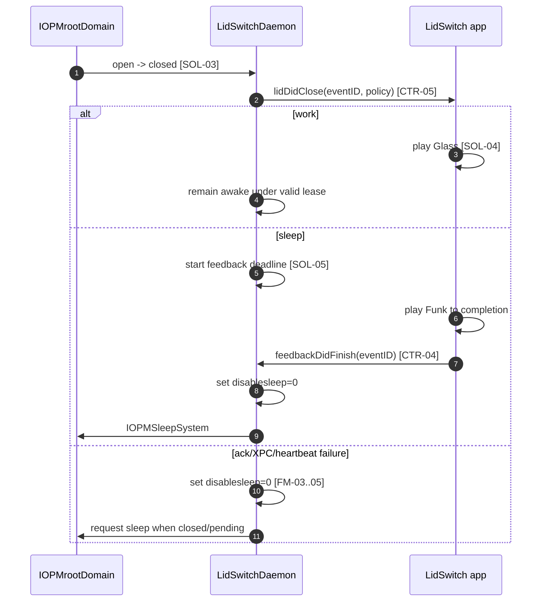

# FT-003: Design

> Gate status: **Solution Ready**. ADR-001 accepted daemon-owned managed lid
> sleep; this pack fixes component responsibilities, XPC contract, ordering,
> fail-safe degradation and physical acceptance boundaries.

## Design Pack

| Artifact | Relation | Direct canonical ownership | Readiness / source |
| --- | --- | --- | --- |
| `design.md` | `root` | Manifest, `SOL-*`, `C4-*`, `SD-*`, `INV-*`, `FM-*`, `RB-*` | `status: active` |
| `contracts/managed-lid-control.md` | `constituent` | `CTR-01..07` app-daemon connector | `Status: accepted` |
| `../../adr/ADR-001-daemon-owned-lid-sleep.md` | accepted decision | runtime ownership, lease and fail-safe rationale | `active + accepted` |

## Context

The root-domain clamshell message arrives shortly before a sleep-causing lid
transition. Public power assertions do not block lid sleep, so a guaranteed
sound-before-sleep sequence requires managed `disablesleep`. ADR-001 assigns
that privileged state to the embedded root daemon under a short-lived app lease.

The app owns desired user policy and audio UX. The daemon owns actual wake
inhibition, lid transition detection, deadlines and the final sleep request.
Energy modes remain on the existing helper boundary.

## Selected Solution

- `SOL-01`: Promote `LidSwitchDaemon` from check-version spike to the sole owner
  of managed lid policy. On startup without a valid lease it restores
  `disablesleep=0`; it never persists an active lease.
- `SOL-02`: Add a pure deterministic managed-lid state machine. An authenticated
  app lease supplies desired `work`/`sleep`, heartbeat keeps it valid, and only
  known `open -> closed` emits one event.
- `SOL-03`: Daemon observes `IOPMrootDomain` general-interest clamshell changes,
  reads optional lid state, applies state-machine actions through fixed adapters
  for `/usr/bin/pmset` and `IOPMSleepSystem`, and owns lease/feedback timers.
- `SOL-04`: App keeps a persistent authenticated XPC connection, reactivates its
  desired policy after launch/wake, and plays built-in `Glass` for work and
  `Funk` for sleep through `NSSound`. A sound delegate acknowledges completion
  using the daemon-generated event ID.
- `SOL-05`: In sleep policy, daemon starts a bounded feedback deadline. On valid
  acknowledgement or deadline it restores `disablesleep=0` before requesting
  sleep. On connection/heartbeat loss it restores native sleep immediately and,
  when the lid is closed or sleep is pending, also requests sleep.
- `SOL-06`: The menu exposes daemon readiness as the prerequisite for managed
  lid switching. Unknown/unapproved/incompatible daemon state is not shown as a
  confirmed work/sleep policy; existing helper remains only for energy modes.

## C4 Applicability

| C4 ID | Decision | Trigger / reason | Artifact |
| --- | --- | --- | --- |
| `C4-L2-01` | `required` | Runtime ownership moves across app/daemon trust boundary and changes deployable interactions | embedded Container view below |

```mermaid
flowchart LR
    U[User] -->|selects policy / hears outcome| A[LidSwitch app\nAppKit + NSSound]
    A -->|authenticated persistent XPC\nlease, heartbeat, ack| D[LidSwitchDaemon\nroot Service Management daemon]
    D -->|clamshell observation| I[IOPMrootDomain]
    D -->|fixed disablesleep mutation| P[/usr/bin/pmset]
    D -->|explicit sleep| S[IOPMSleepSystem]
    A -->|energy-mode operations only| H[LidSwitchHelper]
```

## 4+1 Viewpoint Coverage Decision

| View | Stakeholders / concerns | Status | Canonical refs | Supporting projection |
| --- | --- | --- | --- | --- |
| Logical | user/product; correct outcome | covered | `SOL-02`, `SOL-04..06`, `INV-01..04` | policy table |
| Process | runtime; callback, ack, timeout, loss | covered | `SOL-02..05`, `CTR-01..07`, `FM-01..07` | sequence below |
| Development | maintainers; pure core and adapters | covered | `SD-01..04`, `C4-L2-01` | C2 view |
| Physical | release/ops; root daemon registration and MacBook | covered | `SOL-01`, `SOL-06`, `RB-01..02` | C2 + hardware gate |
| Scenarios (+1) | user/reviewer; normal and failure paths | covered | `SC-01..03`, `NEG-01..02` | sequence and failure table |

## Architecture Coverage Decision

| Aspect | Status | Canonical refs | Coverage note |
| --- | --- | --- | --- |
| Components / responsibilities | covered | `C4-L2-01`, `SOL-01..06`, `SD-01..04` | app/audio, pure policy, daemon/adapters, legacy helper split |
| Connectors / interactions | covered | delegated `CTR-01..07` | persistent bidirectional XPC and macOS adapters |
| Configuration / topology | covered | `SOL-01`, `SOL-06`, `RB-01..02` | embedded registered root daemon required |
| Behavioral semantics | covered | `INV-01..06`, policy table, sequence | initial/duplicate/unknown/timeout/loss explicit |
| Quality / evolution | covered | `FM-01..07`, `RB-01..02`, ADR-001 | safe degradation and hardware compatibility gate |

## Policy And Transition Semantics

| Previous lid | Current lid | Active lease policy | Result |
| --- | --- | --- | --- |
| unknown/initial | any | any | establish state; no outcome |
| open | closed | work | one work callback/sound; keep `disablesleep=1` |
| open | closed | sleep | one sleep callback; await ack until deadline; then safe sleep |
| open | closed | no valid lease | native sleep remains enabled; no app outcome |
| closed | closed | any | duplicate; no new event |
| closed | open | active lease | arm next closure |
| any | unknown | any | break known transition chain; no outcome |

## Managed Sleep Sequence



## Alternatives Considered

| Alternative | Option | Why not selected |
| --- | --- | --- |
| `ALT-01` | Native sleep plus best-effort sound | Cannot guarantee sound completion before suspension |
| `ALT-02` | App-only `disablesleep` ownership | App crash can strand a closed Mac awake |
| `ALT-03` | Separate new watchdog/helper | Adds another deployable and approval lifecycle without benefit over existing daemon |
| `ALT-04` | Ten-second or faster polling | Timing race/wakeups; clamshell notification is the correct event source |
| `ALT-05` | Bundled custom audio | Adds packaging/licensing surface without evidence system sounds are insufficient |

## Accepted Local Decisions

- `SD-01`: Put the pure state machine in a new `LidSwitchDaemonCore` target so
  daemon decisions are testable without Foundation XPC, IOKit or root effects.
- `SD-02`: Keep transport enums/constants in `LidSwitchDaemonProtocol`; expose
  only primitive Objective-C-compatible fields and exact selectors.
- `SD-03`: Assemble the SDK clamshell message identifier from header macros when
  Swift does not import the macro, with a source citation and hardware check.
- `SD-04`: Use bounded constants owned by daemon code: heartbeat cadence/lease
  timeout and feedback deadline. Tests use explicit expiration events rather
  than wall-clock sleeps; tuning values may change compatibly without changing
  contract semantics.

## Contracts

`contracts/managed-lid-control.md` is the only direct owner of `CTR-01..07`.

## Invariants

- `INV-01`: At most one close event ID per known `open -> closed` transition.
- `INV-02`: Unknown lid, missing lease or incompatible protocol never produces a
  work/sleep callback.
- `INV-03`: Only the current authenticated connection may renew its lease or
  acknowledge its current pending event.
- `INV-04`: Sleep request is never issued before feedback acknowledgement unless
  the bounded deadline or control failure has occurred.
- `INV-05`: Every path that explicitly requests sleep first restores
  `disablesleep=0`.
- `INV-06`: No active lease or daemon restart implies native sleep enabled; a
  privileged keep-awake state is never persisted.

## Failure Modes

| ID | Failure | Required behavior |
| --- | --- | --- |
| `FM-01` | Clamshell registration/read fails | Log diagnostic; no misleading callback; lease watchdog still operates |
| `FM-02` | Named sound unavailable | No substitute outcome; sleep path still acknowledges playback failure immediately and proceeds safely |
| `FM-03` | Feedback callback/delegate never completes | Deadline restores native sleep and requests sleep |
| `FM-04` | XPC invalidates/interruption occurs | Revoke lease, restore native sleep, request sleep if closed/pending |
| `FM-05` | Heartbeat expires | Same fail-safe as connection loss |
| `FM-06` | Stale/duplicate acknowledgement | Ignore; never affect a newer event or lease |
| `FM-07` | `IOPMSleepSystem` fails | Native lid sleep is already restored; log failure for hardware evidence |

## Rollout / Backout

| Stage | Entry condition | Backout |
| --- | --- | --- |
| `RB-01` | Automated build/core/protocol checks green; daemon registration and version handshake work | Do not activate lease; retain native `disablesleep=0` and energy helper |
| `RB-02` | Physical MacBook matrix confirms sounds, post-sound sleep and forced-failure paths | Unregister/revert managed daemon behavior; explicitly restore native sleep; feature remains not Done |

## Design Verification

| Analysis | Result / evidence |
| --- | --- |
| Contract compatibility | Intentional breaking expansion from M2 spike; exact-version handshake prevents mixed-version lease |
| State / transition completeness | Policy table covers initial, duplicate, unknown, work, sleep and no-lease states |
| Failure propagation | Every loss/timeout path converges on restore-native-sleep before optional explicit sleep |
| Concurrency / ordering | Daemon serializes state machine, timers and connection ownership; app audio callback returns event ID |
| Security boundaries | Existing bilateral code-sign requirements retained; capability protocol has no arbitrary command/argument |
| Capacity / latency | One event and bounded timer per transition; physical audibility remains manual-only |
| Migration / evolution | No persisted lease; old helper no longer owns lid policy; incompatible daemon cannot activate managed behavior |

## External Dependency Readiness

No new third-party dependency. macOS IOKit, ServiceManagement, AppKit and the
embedded daemon are required runtime surfaces. The production live gate and
physical-lid checks remain required evidence before delivery is Done.

## Traceability

| Requirement | Solution | Contract / invariants | Failure / rollout |
| --- | --- | --- | --- |
| `REQ-01..04` | `SOL-02..04`, `C4-L2-01` | `CTR-01..06`, `INV-01..03` | `FM-01`, `FM-06`, `RB-01` |
| `REQ-05` | `SOL-04` | `INV-04` | `FM-02`, `RB-02` |
| `REQ-06` | `SOL-01..05` | `CTR-01..07`, `INV-04..06` | `FM-03`, `FM-07`, `RB-02` |
| `REQ-07` | `SOL-01..03`, `SOL-05` | `CTR-03`, `CTR-06..07`, `INV-03..06` | `FM-04..07`, `RB-01..02` |
